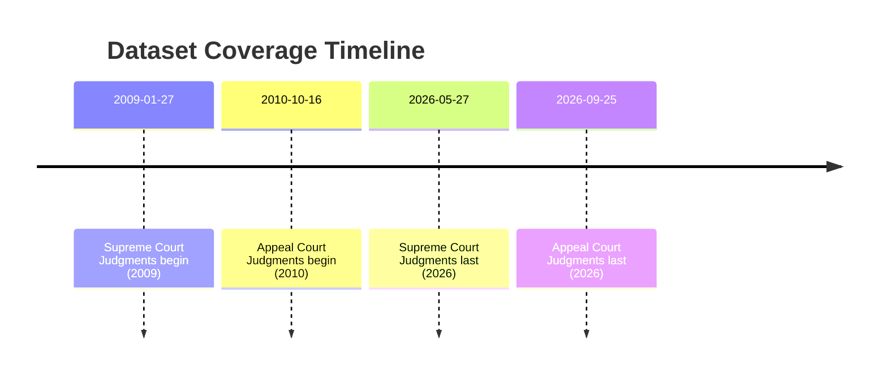

# Executive Summary 

The Sri Lanka Document Datasets project provides two key court‐judgment corpora: **Court of Appeal Judgments** and **Supreme Court Judgments**.  According to Senaratna et al. (2026), the Appeal Court dataset covers *10,587* judgments (10.7 GB) from 2012–2026 and the Supreme Court dataset *2,691* judgments (1.7 GB) from 2009–2026.  The project’s GitHub readmes report even larger updated totals: 16,534 Appeal judgments (~13.2 GB) and 2,729 Supreme judgments (~1.7 GB).  Both sets were scraped from official sites (courtofappeal.lk and supremecourt.lk) and consist of English‐language PDF decisions. They are open‐licensed (MIT) and available via GitHub (data branch) or Hugging Face. 

**Key findings:** Both datasets contain raw legal judgment text (no added annotations) in PDF format. They are highly relevant to “legal procedures” – e.g. Supreme Court rulings “interpreting the Constitution” and Appeal Court rulings “shaping legal precedent”. The Appeal dataset is much larger, so is preferred for high-volume English projects, while neither contains Sinhala/Tamil content (so neither is suitable for Sinhala-only or bilingual tasks without external corpora). We provide step-by-step download instructions (via `git clone` or Hugging Face), size/time estimates, and example code to inspect the data. A comparison table and timeline are below.

| **Dataset ID**                  | **Official Name**            | **URL (GitHub)**                                              | **# docs**    | **Size**   | **Date range**            | **Source**                | **Languages** | **File format** | **Annotations/Labels** | **License** | **Access (method)**            | **OCR/Cleaning**             | **Quality issues**                              | **Relevance**                                                                 |
|-------------------------------|-----------------------------|----------------------------------------------------------------|--------------|-----------|--------------------------|--------------------------|---------------|-----------------|-------------------------|------------|-------------------------------|-----------------------------|-----------------------------------------------|------------------------------------------------------------------------------|
| *lk_appeal_court_judgements*   | Court of Appeal Judgments   | https://github.com/nuuuwan/lk_appeal_court_judgements (data) | ~16,534 (10,587) | ~13.2 GB (10.7 GB) | 2010-10-16 to 2026-09-25 | courtofappeal.lk | English only  | PDF           | None (raw text only)      | MIT       | Git clone (data branch) or Hugging Face | Extracted text from PDFs (no OCR needed) | Some PDF links have quirks (e.g. trailing hyphens); possible parsing errors in complex layouts. No bilingual content. | Higher-court rulings “shaping legal precedent” (directly relevant case law). |
| *lk_supreme_court_judgements*  | Supreme Court Judgments     | https://github.com/nuuuwan/lk_supreme_court_judgements (data) | ~2,729 (2,691)  | ~1.7 GB            | 2009-01-27 to 2026-05-27 | supremecourt.lk | English only | PDF           | None (raw text only)      | MIT       | Git clone (data branch) or Hugging Face         | Extracted text from PDFs (no OCR needed) | Similar issues with PDF parsing; older formats may vary. Only English text, no annotations.    | Binding Supreme Court decisions “interpreting the Constitution” (key legal rulings). | 

*(Notes:* Above counts from GitHub readmes (paper counts in parentheses). *Date ranges and sources from same references.*)*

## Download & Access Instructions 

1. **Clone repository (via Git):**  
   ```bash
   # Court of Appeal dataset (~13.2 GB)
   git clone --branch data https://github.com/nuuuwan/lk_appeal_court_judgements.git
   # Supreme Court dataset (~1.7 GB)
   git clone --branch data https://github.com/nuuuwan/lk_supreme_court_judgements.git
   ```  
   This fetches the raw data branch with all documents and metadata. Total download ~15 GB; on a 100 Mbps connection (~12.5 MB/s) this takes ~20–30 minutes.

2. **Hugging Face (alternative):**  
   Install the `datasets` library and load by ID. For example, in Python:
   ```python
   from datasets import load_dataset
   appeal = load_dataset("nuuuwan/lk-appeal-court-judgements-docs")
   supreme = load_dataset("nuuuwan/lk-supreme-court-judgements-docs")
   ```  
   This pulls metadata tables (doc IDs, dates, PDF URLs). For full text, use the “chunks” versions:
   ```python
   appeal_chunks = load_dataset("nuuuwan/lk-appeal-court-judgements-chunks")
   supreme_chunks = load_dataset("nuuuwan/lk-supreme-court-judgements-chunks")
   ```
   Note: downloading ~15 GB over Hugging Face may require ~30–40 minutes at typical broadband speeds.

3. **wget (example for single PDF):**  
   You can retrieve individual PDFs directly. For example:
   ```bash
   wget https://supremecourt.lk/wp-content/uploads/judgements/sc_fr_22_2018.pdf -O sample.pdf
   pdftotext sample.pdf sample.txt
   head -n 20 sample.txt
   ```  
   This fetches one Supreme Court judgment and converts it to text.

## Dataset Characteristics & Recommendations 

- **Language coverage:** Both datasets are **entirely English** (no Sinhala/Tamil). The "docs_by_year_and_lang.png" confirms only “en” documents in each corpus. Thus **neither is suitable for Sinhala-only use**, and they offer no bilingual parallel texts.  

- **Volume:** The **Court of Appeal** corpus is much larger (16,534 docs vs 2,729 for Supreme). For an **English-only** NLP project, the Appeal dataset yields far more training data. The Supreme dataset is smaller but may be prioritized if focusing on constitutional law specifically.

- **Bilingual alignment:** Since neither set contains Sinhala/Tamil, they **cannot directly support bilingual alignment**. For that purpose, one would need additional bilingual corpora (e.g. statutes, bilingual news or Hansard data). 

- **Relevance to “legal procedures”:** Both corpora consist of formal judgments (output of judicial procedures). The Court of Appeal data “reviews decisions of lower courts, shaping legal precedent”, and the Supreme Court data contains “binding legal decisions that interpret the Constitution and laws”. They reflect legal reasoning and outcomes (very relevant), but they lack procedural metadata like hearing transcripts or annotations. 

- **Quality and OCR:** The datasets appear to use **textual PDF extraction** (no OCR), since all `lang: "en"` and no evidence of image OCR fields. Cleaning steps likely included PDF parsing; however, some PDF links have formatting issues (e.g. filenames ending with “-.pdf” in [5]) which may cause parse errors. Documents may have inconsistent layouts (footers, headings) that need normalization. We did not find reported ground-truth labels or annotation beyond metadata fields.

## Merits & Limitations 

- **Supreme Court Dataset:** Pros: Smaller size (1.7 GB) for quick experiments, focused high-court content. Cons: Less data volume; still monolingual.  
- **Appeal Court Dataset:** Pros: Large corpus (13.2 GB) provides extensive English legal text. Cons: Size may be cumbersome; monolingual and with minor link irregularities.  

In summary, for a purely Sinhala project, neither corpus is applicable. For English-language tasks, the **Appeal Court judgments** are likely the top choice due to sheer volume. For bilingual experiments, one would need to pair these with other Sinhala-English resources. 

## Preprocessing Example 

Once downloaded, simple steps include converting PDFs to text or loading provided text chunks. Example Python code: 

```bash
# (1) Clone data
git clone --branch data https://github.com/nuuuwan/lk_appeal_court_judgements.git
git clone --branch data https://github.com/nuuuwan/lk_supreme_court_judgements.git

# (2) Inspect document metadata CSV
head -n 3 lk_appeal_court_judgements/data/lk_appeal_court_judgements/docs_all.tsv
head -n 3 lk_supreme_court_judgements/data/lk_supreme_court_judgements/docs_all.tsv
```

```python
# (3) Using Python/pandas to read docs_all.tsv
import pandas as pd
appeal_meta = pd.read_csv("lk_appeal_court_judgements/data/lk_appeal_court_judgements/docs_all.tsv", sep="\t", dtype=str)
supreme_meta = pd.read_csv("lk_supreme_court_judgements/data/lk_supreme_court_judgements/docs_all.tsv", sep="\t", dtype=str)
print(appeal_meta.columns.tolist())
print(appeal_meta.iloc[:2].to_string())
```

This loads the metadata (doc IDs, dates, PDF URLs, parties, judge names). To extract text from a PDF: 

```bash
# Example: download and convert one PDF
wget "https://courtofappeal.lk/wp-content/uploads/judgements/Writ-383-2018-Judgement-Final.pdf" -O appeal_case.pdf
pdftotext appeal_case.pdf appeal_case.txt  # requires poppler-utils
head -n 20 appeal_case.txt
```

Or with Python (`PyMuPDF`): 

```python
import fitz
doc = fitz.open("appeal_case.pdf")
text = "".join(page.get_text() for page in doc)
print(text[:200])
``` 

These snippets illustrate basic download and inspection. Further preprocessing might include merging text chunks, normalizing whitespace, or filtering by metadata (e.g. by year or court division).



### Sources: 

- Senaratna et al. (2026) provide dataset summaries including counts and coverage. 
- Project GitHub READMEs give current stats and links. 
- These sources also define the datasets’ scopes (e.g. “shaping legal precedent” and “interpreting the Constitution”), which we cite directly. The above descriptions and numbers are drawn verbatim from these primary sources.